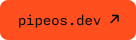
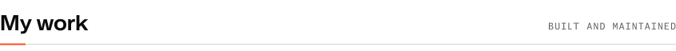
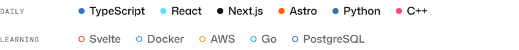
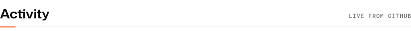

<picture><source media="(prefers-color-scheme: dark)" srcset="assets/header-dark.svg"></picture>

  <a href="https://pipeos.dev"><picture><source media="(prefers-color-scheme: dark)" srcset="assets/link-portfolio-dark.svg"></picture></a>
  <a href="https://www.linkedin.com/in/pipeos/"><picture><source media="(prefers-color-scheme: dark)" srcset="assets/link-linkedin-dark.svg"></picture></a>
  <a href="mailto:felipearce.2004@gmail.com"><picture><source media="(prefers-color-scheme: dark)" srcset="assets/link-email-dark.svg"></picture></a>

 

<picture><source media="(prefers-color-scheme: dark)" srcset="assets/title-oss-dark.svg"></picture>

<a href="https://github.com/withastro/astro"><picture><source media="(prefers-color-scheme: dark)" srcset="https://raw.githubusercontent.com/pipe1os/pipe1os/cards-output/pin-withastro-astro-dark.svg"></picture></a><a href="https://github.com/trpc/trpc"><picture><source media="(prefers-color-scheme: dark)" srcset="https://raw.githubusercontent.com/pipe1os/pipe1os/cards-output/pin-trpc-trpc-dark.svg"></picture></a><a href="https://github.com/strands-agents/harness-sdk"><picture><source media="(prefers-color-scheme: dark)" srcset="https://raw.githubusercontent.com/pipe1os/pipe1os/cards-output/pin-strands-agents-harness-sdk-dark.svg"></picture></a>

<a href="https://github.com/boykopovar/AnyPS5"><picture><source media="(prefers-color-scheme: dark)" srcset="https://raw.githubusercontent.com/pipe1os/pipe1os/cards-output/pin-boykopovar-anyps5-dark.svg"></picture></a>

 

<picture><source media="(prefers-color-scheme: dark)" srcset="assets/title-work-dark.svg"></picture>

<a href="https://github.com/pipe1os/shipdot"><picture><source media="(prefers-color-scheme: dark)" srcset="https://raw.githubusercontent.com/pipe1os/pipe1os/cards-output/pin-pipe1os-shipdot-dark.svg"></picture></a><a href="https://github.com/pipe1os/modelinfo-cli"><picture><source media="(prefers-color-scheme: dark)" srcset="https://raw.githubusercontent.com/pipe1os/pipe1os/cards-output/pin-pipe1os-modelinfo-cli-dark.svg"></picture></a><a href="https://github.com/CEOUBB/CEOUBB"><picture><source media="(prefers-color-scheme: dark)" srcset="https://raw.githubusercontent.com/pipe1os/pipe1os/cards-output/pin-ceoubb-ceoubb-dark.svg"></picture></a>

I also run <a href="https://kumoweb.cl">Kumo</a>, a studio that builds websites and custom software for small businesses across Chile.

 

<picture><source media="(prefers-color-scheme: dark)" srcset="assets/title-stack-dark.svg"></picture>

<picture><source media="(prefers-color-scheme: dark)" srcset="assets/stack-dark.svg"></picture>

 

<picture><source media="(prefers-color-scheme: dark)" srcset="assets/title-activity-dark.svg"></picture>

<picture><source media="(prefers-color-scheme: dark)" srcset="https://raw.githubusercontent.com/pipe1os/pipe1os/cards-output/stats-dark.svg"></picture><picture><source media="(prefers-color-scheme: dark)" srcset="https://raw.githubusercontent.com/pipe1os/pipe1os/cards-output/top-langs-dark.svg"></picture>

<picture><source media="(prefers-color-scheme: dark)" srcset="https://raw.githubusercontent.com/pipe1os/pipe1os/streak-output/streak-dark.svg"></picture>

